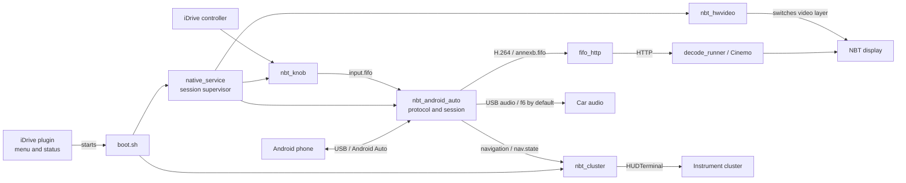

# NBT Android Auto

[](https://github.com/mbalous/nbt-android-auto/actions/workflows/ci.yml)

Wired Android Auto for the original BMW NBT head unit, using its existing display, audio system and iDrive controller.
No separate Android Auto interface is needed. NBT Evo and CIC are not supported.

> **Experimental:** This merged build has had limited parked testing. Projection, knob input and wired audio worked
> after a cable swap, but full vehicle testing is still pending. Host CI does not verify QNX compatibility or vehicle
> safety. Read the [disclaimer](#disclaimer) before installing.

> **Warning:** NEVER run `/sbin/shutdown` on the BMW NBT head unit. It causes a boot lock that can only be cleared by
> disconnecting the vehicle battery. If you need to restart the head unit, use the
> [documented NBT restart procedure](src/idrive/reboot/README.md).

[Video of an earlier prototype](https://www.instagram.com/reel/DfkW1wYsB__/) ·
[Vehicle test notes](CAR-TEST-aa-dev.md) · [Changelog](CHANGELOG.md)

## What works

- **Video:** 800×480 through the stock video path, with full-width and 16:9 picture modes.
- **Controls:** turn, tilt and press the iDrive controller to navigate; BACK goes back. NAV brings Android Auto
  forward and, when already open, switches to its audio or toggles playback.
- **Audio:** USB audio uses the `f6` source by default. Calls and the microphone still use Bluetooth.
- **Navigation:** a compatible 6WB cluster can show Google Maps guidance, including arrows, distance and street names.
  BMW navigation takes priority. Lane display has not yet been confirmed with a real phone.
- **iDrive menu:** **Multimedia → Android Auto** shows status, opens the session and offers a service restart.
  An optional setting brings Android Auto forward at boot.

The controller has noticeable video-buffer delay. Its bridge cannot stop iDrive from receiving the same events, so
right tilts can also affect the factory split screen. For an uninterrupted picture, turn off the factory split screen
in iDrive's OPTION menu and select **Full width** on the Android Auto page.

The optional browser audio route and source switching still need vehicle testing. USB audio failures can cause the
next session to fall back to Bluetooth. Software volume on `f6` may be attenuated again by the car; see
[configuration](#configuration-and-diagnostics). The experimental wired microphone and coding viewer are not included.

## Requirements

- Original BMW NBT, not NBT Evo or CIC.
- SSH root access to the head unit.
- Linux or WSL laptop connected to the car by ENET; the usual NBT address is `169.254.199.99`.
- Android phone and USB cable.

### Enable SSH

Stock NBT does not accept SSH logins. The developer used FeatureInstaller to unlock it; this can take several attempts
and may report an error even when it succeeds. Check with `ssh root@169.254.199.99`. The default root password is
`ts&SK412`.

Alternatively, follow the [serial-port SSH guide](docs/SSH-ACCESS-SERIAL.md). Unlocking SSH changes the head unit's
configuration and is at your own risk.

## Install

If upgrading from a version before the executable rename, uninstall the old package and restart iDrive first. The
installer does not migrate old files.

1. Build a payload in the QNX VM using [the development guide](docs/DEVELOPMENT.md), or unpack a matching Python
   payload archive. Check [Releases](../../releases) for availability; older upstream releases do not contain this
   merged version. No prebuilt release of the merged version is currently available.
2. Connect ENET, switch on the ignition and install the Python dependency:
   ```sh
   pip3 install "paramiko>=3.4,<4"
   ```
3. With `installer/payload/` present, run the GUI or CLI:
   ```sh
   python3 installer/nbt_aa_installer.py
   # or
   python3 installer/nbt_aa_installer.py --cli install
   ```
4. Enter the NBT address and root password, then install. Restart iDrive, connect the phone over USB and select
   **Multimedia → Android Auto**.

The installer verifies uploaded files, does not store the password and can remove its two installation folders.
See the [installer guide](installer/README.md) for WSL, host-key checking, recovery and uninstall details.

## How it fits together



The supervisor manages the phone session and its helper processes. The plugin provides the iDrive entry point;
`nbt_hwvideo` switches the stock video layer to the decoded stream. See the [source map](src/README.md) for process
and source-file details.

## Configuration and diagnostics

Optional switches are files in `/var/opt/hmi/data/rw/NbtAndroidAutoRT/`. Restart the Android Auto service after
changing them, unless noted otherwise.

| File | Effect |
|---|---|
| `aa-audio` | Use the browser USB audio route instead of `f6`. |
| `bt-audio` | Use Bluetooth audio instead of USB. |
| `aa-volume-off` | Disable software media-volume adjustment. |
| `prompts-off` | Disable prompts over other car audio sources. |
| `video.fps` | Set the video ACK rate limit (0–60; default 20, 0 disables the limit). |
| `video.gate.off` | Disable decoder-paced video ACKs; the rate limit still applies. |
| `video.drop-idr` | Experimental: request a fresh keyframe after a video queue drop by briefly cycling phone video focus. Off by default; not yet car-tested. |
| `tls-allow-date-errors` | Allow expired or not-yet-valid phone certificates; other certificate checks remain enforced. |
| `incident-logging` | Enable bounded persistent incident snapshots and event logs. |
| `extended-log-history` | Enable bounded persistent boot-log history, starting at the next head-unit boot. |

Baseline logs and restart snapshots are enabled without these switches. Logs can contain phone and vehicle details;
review them before sharing. More options and the test checklist are in [CAR-TEST-aa-dev.md](CAR-TEST-aa-dev.md).

For a bug report, use **Save diagnostic logs** in the installer and attach the ZIP to an
[issue](../../issues/new?template=bug_report.md). Include the car model, build year, NBT software level and phone model.

## Development

Vehicle binaries are built in a QNX 6.5.0 VM. Start with [development](docs/DEVELOPMENT.md),
[build and debug commands](docs/WORKFLOW.md), and [contributing](CONTRIBUTING.md). The
[open toolchain](toolchain/README.md) is experimental and not the supported vehicle deployment path.

Technical notes: [video](docs/HW-VIDEO-PATH.md), [cluster](docs/CLUSTER-HUDTERMINAL.md),
[Android Auto](docs/ANDROID-AUTO.md), [audio](docs/AA-AUDIO-PLAN.md), and
[fork changes](docs/FORK-CHANGES.md). Past experiments are in [experiments/](experiments/) and
[docs/history/](docs/history/).

## Credits and license

This fork brings together the original [JayJay3071/nbt-android-auto](https://github.com/JayJay3071/nbt-android-auto)
and the [valinet](https://github.com/valinet/nbt-android-auto) and
[adityadroid](https://github.com/adityadroid/nbt-android-auto) forks. Parts of the Android Auto core and controller
code come from [NBT-AAD](https://github.com/Sq00ky/Supra-iDrive6-Android-Auto) by nanaisu.

Licensed under [PolyForm Noncommercial 1.0.0](LICENSE): noncommercial use only. Third-party notices are in
[NOTICE.md](NOTICE.md).

Required Notice: Copyright (c) 2026 nanaisu - NBT-AAD (https://github.com/Sq00ky/Supra-iDrive6-Android-Auto)

## Disclaimer

This unofficial hobby project is not affiliated with BMW AG, Google LLC or Harman. BMW, iDrive and Android Auto are
trademarks of their respective owners.

You modify your head unit at your own risk. There is no warranty; the authors are not liable for damage or warranty
claims. Experiments have crashed and restarted the head unit, and limited parked testing does not establish safety.
Follow local traffic laws and do not operate the phone or system in a way that distracts you while driving.
